# ha-mailbox-card

[](https://www.home-assistant.io/integrations/marketplace/)
[](https://github.com/juju35/ha-mailbox-card/actions/workflows/hacs.yml)
[](https://github.com/juju35/ha-mailbox-card/actions/workflows/validate.yml)
[](https://github.com/juju35/ha-mailbox-card/actions/workflows/lint.yml)
[](https://github.com/juju35/ha-mailbox-card/releases/latest)
[](https://github.com/juju35/ha-mailbox-card/blob/main/LICENSE)
[](https://buymeacoffee.com/julienstep9)

<p align="center"></p>

<p align="center">
  &nbsp;&nbsp;
  &nbsp;&nbsp;
  &nbsp;&nbsp;
  
</p>

An illustrated Lovelace card for a **connected mailbox**: the flag goes up when mail comes, with the time it came, and goes down when the door is opened to collect it.

[](https://my.home-assistant.io/redirect/marketplace_repository/?owner=juju35&repository=ha-mailbox-card&category=plugin)

| Card | Type | What it shows |
|---|---|---|
| [Mailbox](#screenshots) | `custom:mailbox-card` | The mailbox drawn with its flag up when mail has come, the time it came, the Collected button, today's expected parcels and the last 7 days. |
| [Mailbox mini](#mailbox-mini) | `custom:mailbox-mini-card` | Since when mail waits and the parcels on two lines, the last 7 days on the banner, with a zoom to the full card. |

| Mail waiting | Collected |
|---|---|
| 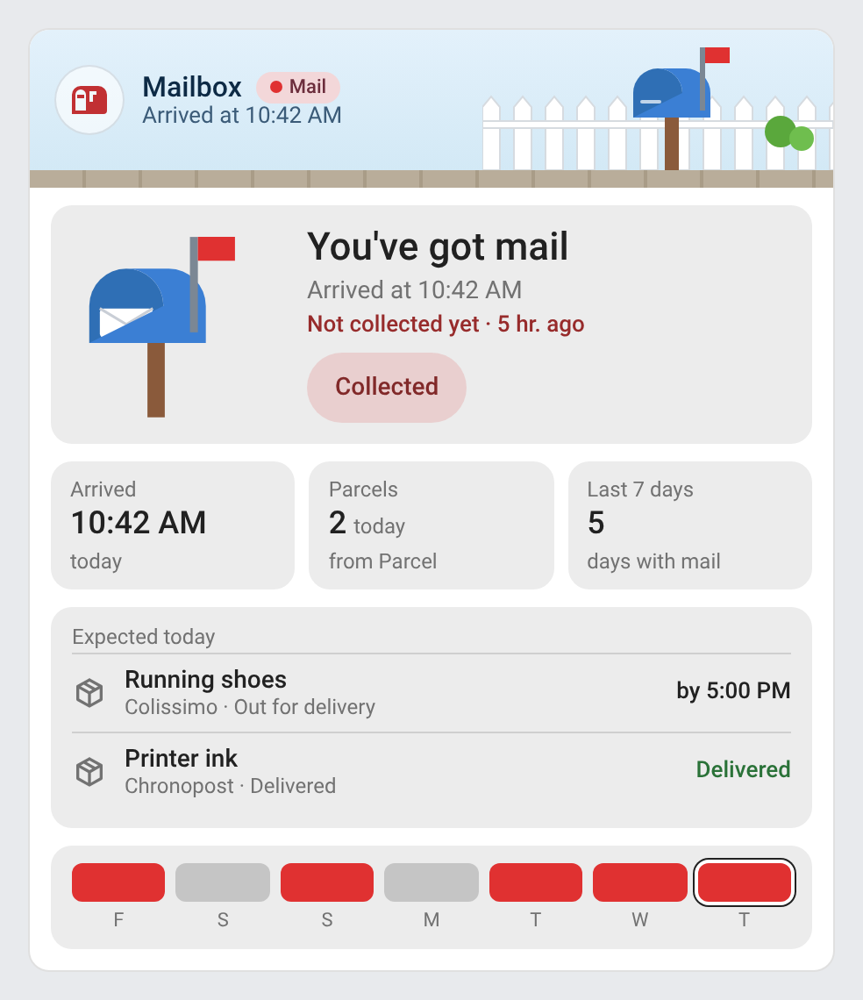 | 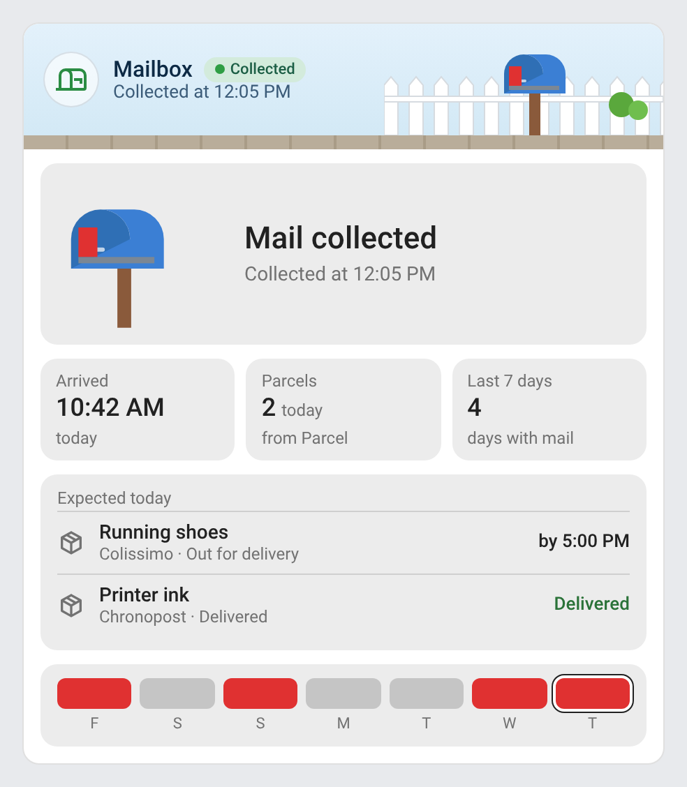 |

## Features

- **The flag goes up** when mail comes: the mail sensor (an opening, vibration or motion sensor on the flap) turning on is a delivery; taps within 10 minutes make one delivery
- **Arrived at**, and how long it has been waiting: *Not collected yet · 5 h ago*
- **Collected**: by the collection door's sensor (opening it collects the mail; the taps it causes on the flap are not mail), or with the **Collected** button, which presses an `input_button` (or sets an `input_datetime` to now)
- **Parcels expected today** from the [Parcel](https://github.com/juju35/ha-parcel) integration, found by itself: out for delivery, expected or delivered today, with the carrier and the time window
- **The last 7 days**: a cell per day, red when mail came, its time in the tooltip, and the number of days with mail
- **Illustrated header**: a picket fence and the mailbox on its post, its red flag up while mail waits (rising, animated), by day and by night
- **Mini card**: since when mail waits (or the last mail) and the parcels as chips, the last 7 days on the banner; its zoom button opens the full card in place
- **Tap a tile** to open its sensor's history
- Visual editor for both cards, light and dark themes, 22 languages, no external dependency

## Supported integrations

Any opening, vibration or motion `binary_sensor` on the mailbox works, from any integration. Parcels expected today can be shown from [Parcel](https://github.com/juju35/ha-parcel). Among the usual ones:

| | Integration | What the cards show |
|:---:|---|---|
|  | [ZHA](https://www.home-assistant.io/integrations/zha/) (built in) | Zigbee door and vibration sensors (Aqara, Sonoff, IKEA…) |
|  | [MQTT](https://www.home-assistant.io/integrations/mqtt/) (built in) | Zigbee2MQTT sensors |
|  | [ESPHome](https://www.home-assistant.io/integrations/esphome/) (built in) | DIY mailbox sensors (reed switch, ToF, load cell) |
|  | [Z-Wave](https://www.home-assistant.io/integrations/zwave_js/) (built in) | Z-Wave door sensors |
| 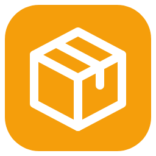 | [Parcel](https://github.com/juju35/ha-parcel) (Marketplace) | The parcels expected today, from its deliveries sensor |

## Installation

### Via the Marketplace (recommended)

Click the button below to add the repository directly:

[](https://my.home-assistant.io/redirect/marketplace_repository/?owner=juju35&repository=ha-mailbox-card&category=plugin)

Or manually:

1. Open **Settings → Marketplace → Add from link** (top right; this needs a GitHub account connected)
2. Add `https://github.com/juju35/ha-mailbox-card` — Type: **Dashboard**
3. Open **Mailbox Card** and click **Install**
4. Clear your browser cache and refresh

The Marketplace registers the dashboard resource for you: `/local/community/ha-mailbox-card/ha-mailbox-card.js`.

### Manual

1. Download `ha-mailbox-card.js` and the `ha-mailbox-card.i18n.*.js` translation files from the [latest release](https://github.com/juju35/ha-mailbox-card/releases/latest)
2. Copy them all to `/config/www/` (without the translation files, the cards show in English)
3. Go to **Settings → Dashboards → Resources** → Add resource:
   - URL: `/local/ha-mailbox-card.js`
   - Type: **JavaScript Module**
4. Clear your browser cache and refresh

## Configuration

Every option is in the visual editor. In YAML:

```yaml
type: custom:mailbox-card
entity: binary_sensor.mailbox_vibration

# With the collection door and a Collected button
type: custom:mailbox-card
entity: binary_sensor.mailbox_flap
door: binary_sensor.mailbox_door
collected: input_button.mail_collected

# Two lines on a phone dashboard
type: custom:mailbox-mini-card
entity: binary_sensor.mailbox_vibration
door: binary_sensor.mailbox_door
```

| Option | Type | Default | Description |
|---|---|---|---|
| `entity` | string | the first binary sensor named like a mailbox | The flap's opening, vibration or motion sensor: mail has come when it turns on |
| `title` | string | `Mailbox` | Card title |
| `show_title` | boolean | `true` | Both: show the title |
| `show_subtitle` | boolean | `true` | Both: the time the mail came (or was collected) under the title |
| `navigation_path` | string | | Both: a tap on the header opens this dashboard path |
| `door` | string | | The collection door's sensor: opening it collects the mail |
| `collected` | string | | An `input_button` (pressed) or `input_datetime` (set to now) for the Collected button; its time is a collection |
| `parcels` | string | the Parcel integration's deliveries sensor | A sensor with a `deliveries` attribute (Parcel's) |
| `show_week` | boolean | `true` | The last 7 days |
| `illustration` | boolean | `true` | Both: the illustrated header (`false`: the classic header) |
| `illustration_theme` | string | `auto` | Both: `auto` (follows the Home Assistant theme: night with a dark theme, day with a light theme), `day` or `night` |
| `animations` | boolean | `true` | Both: the flag rising |
| `zoom` | boolean | `true` | Mini card: the zoom button |
| `language` | string | Home Assistant's | Advanced: one of the [languages](#translations) |

## Screenshots

| Mail waiting | Collected | Empty |
|---|---|---|
|  |  | 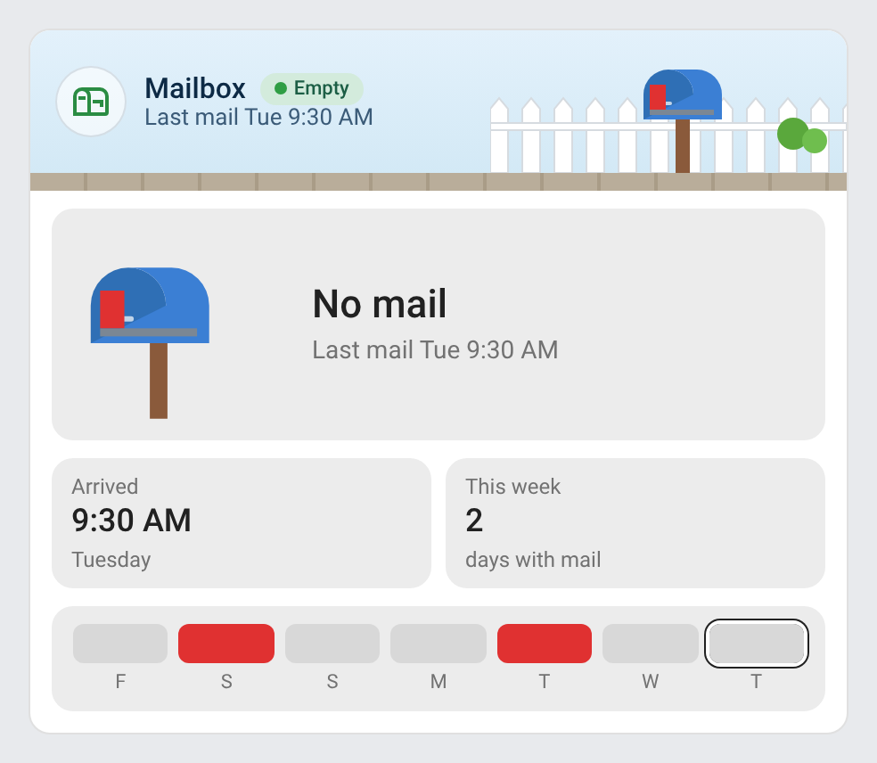 |
| 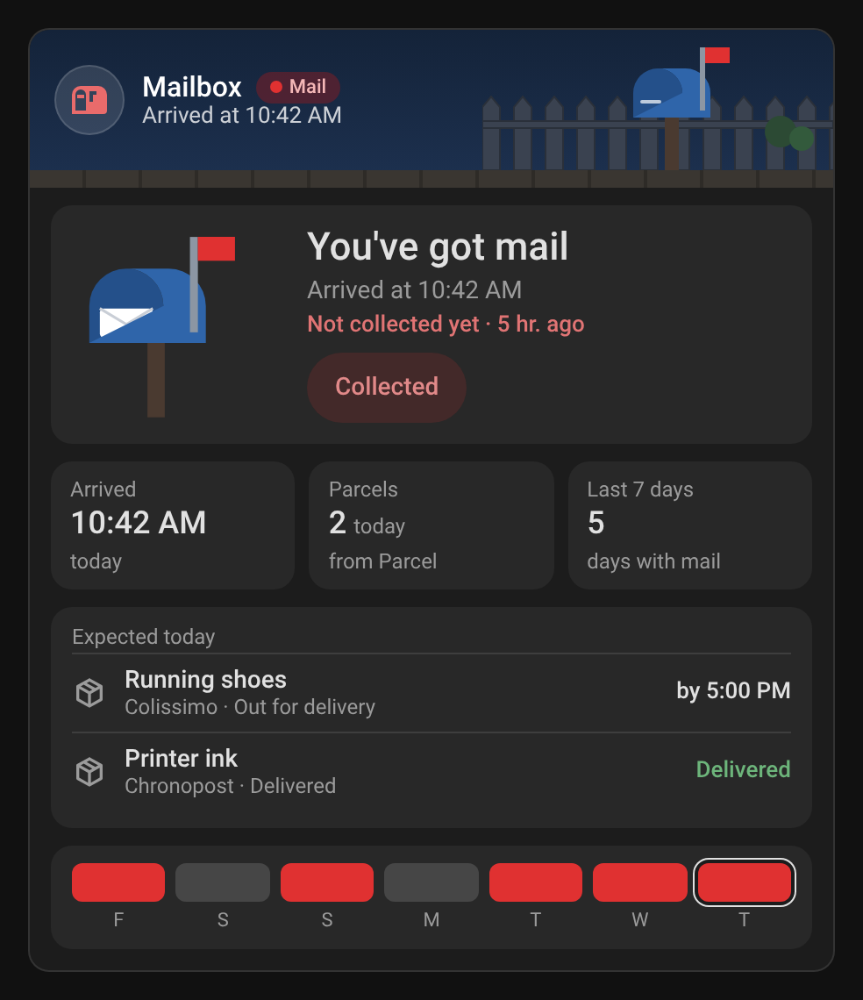 | 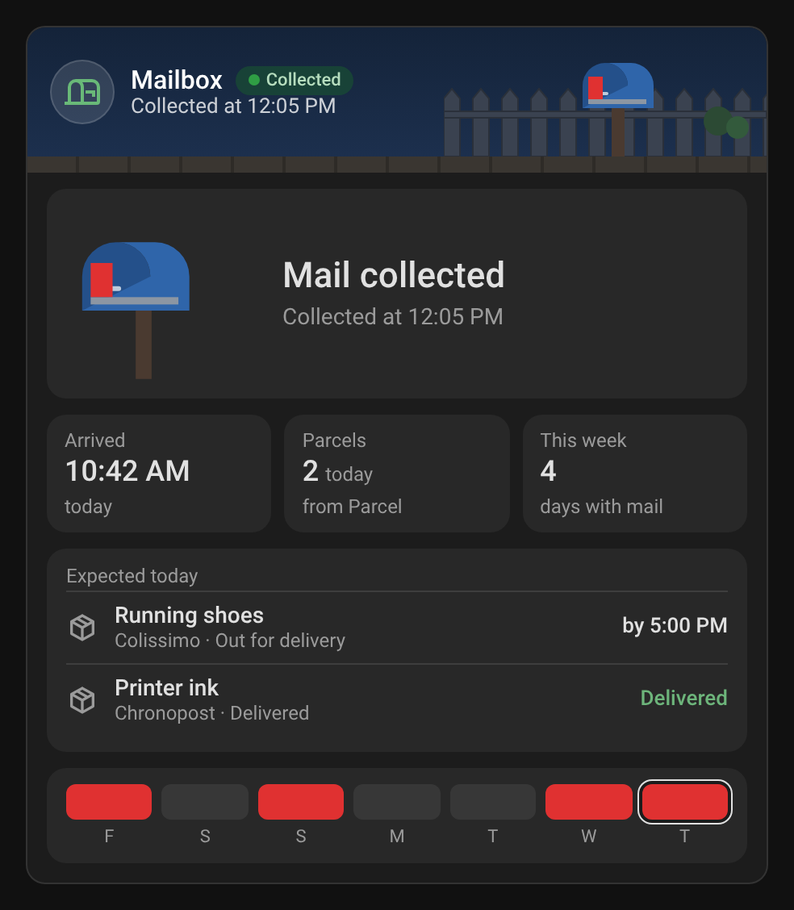 | 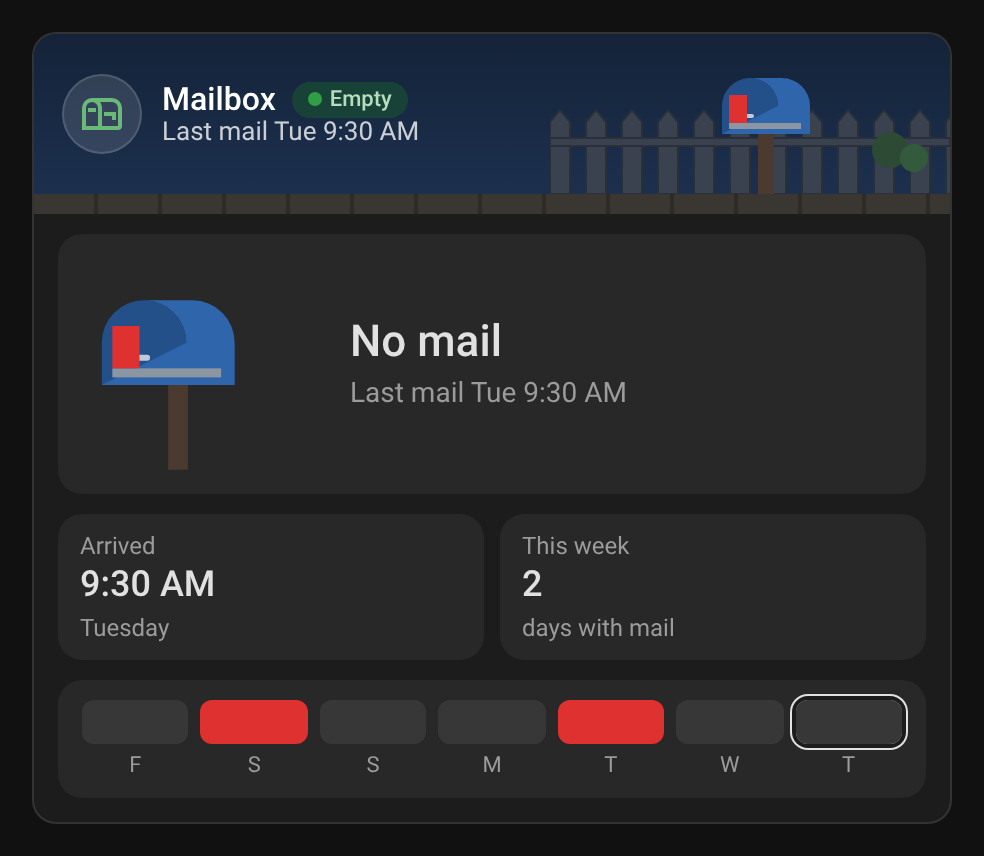 |

| Unavailable | Narrow |
|---|---|
| 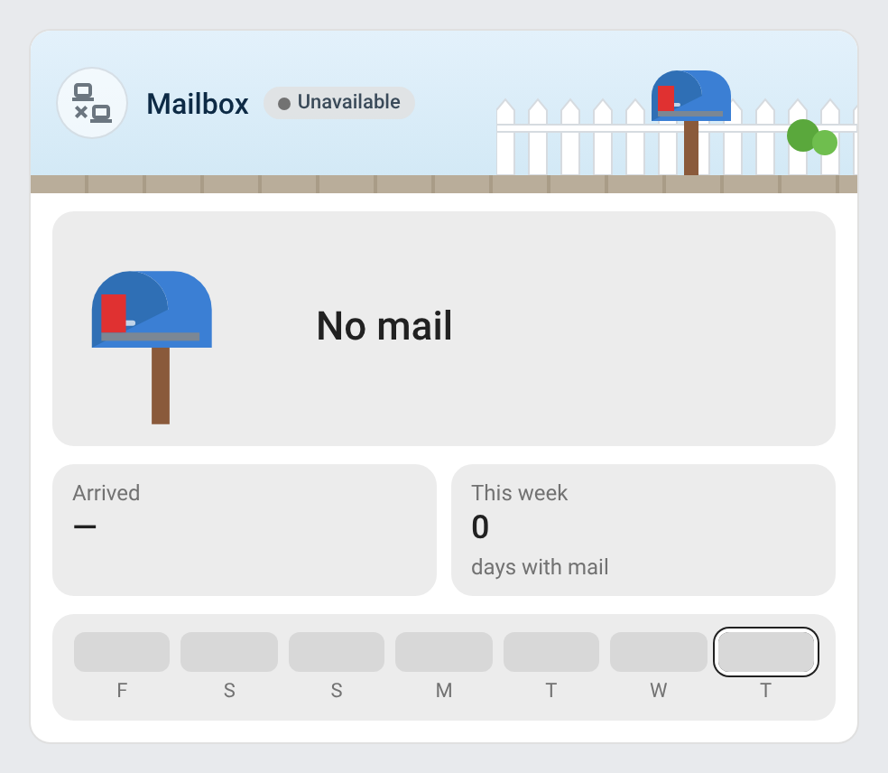 | 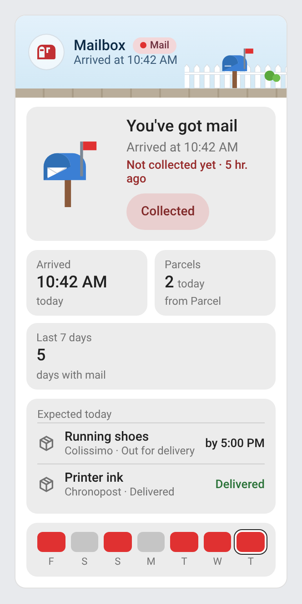 |
| 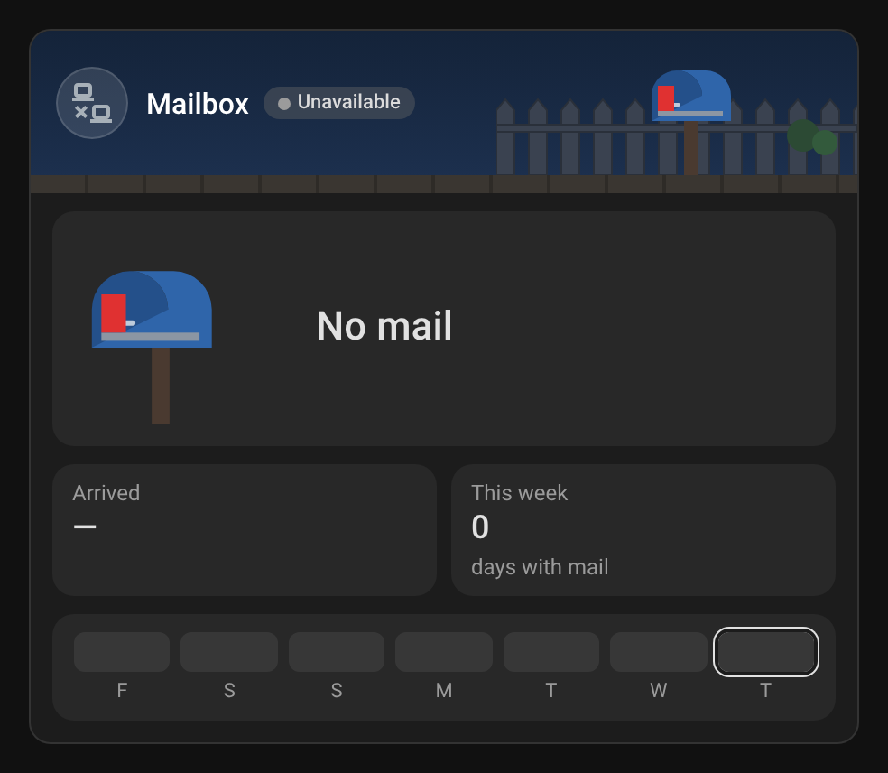 | 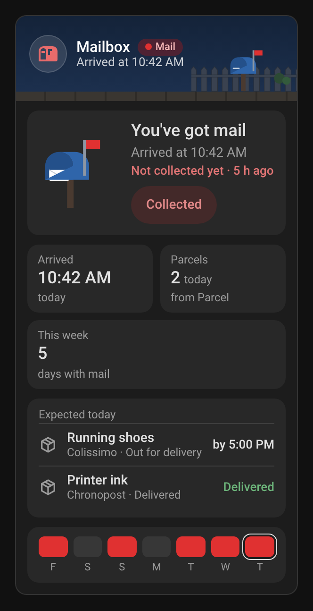 |

**Mail animation**: the flag rises on the mailbox while mail waits (still with `animations: false`, or when the system asks for reduced motion).

| Light | Dark |
|---|---|
| 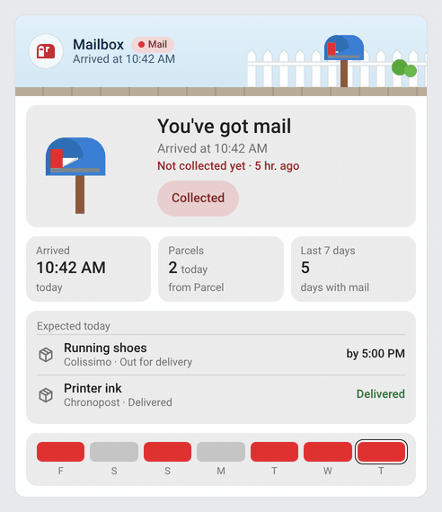 | 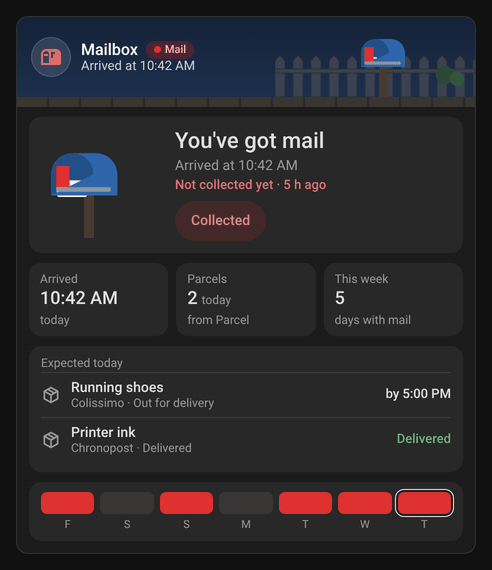 |

### Mailbox mini

| Mail waiting | Empty | Zoomed in |
|---|---|---|
| 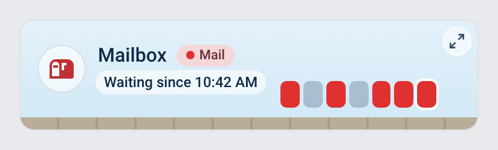 | 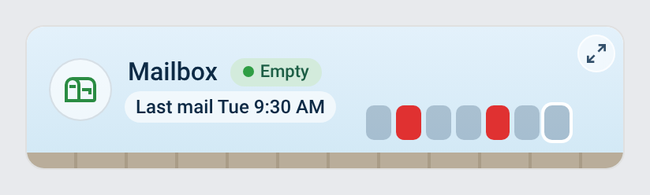 | 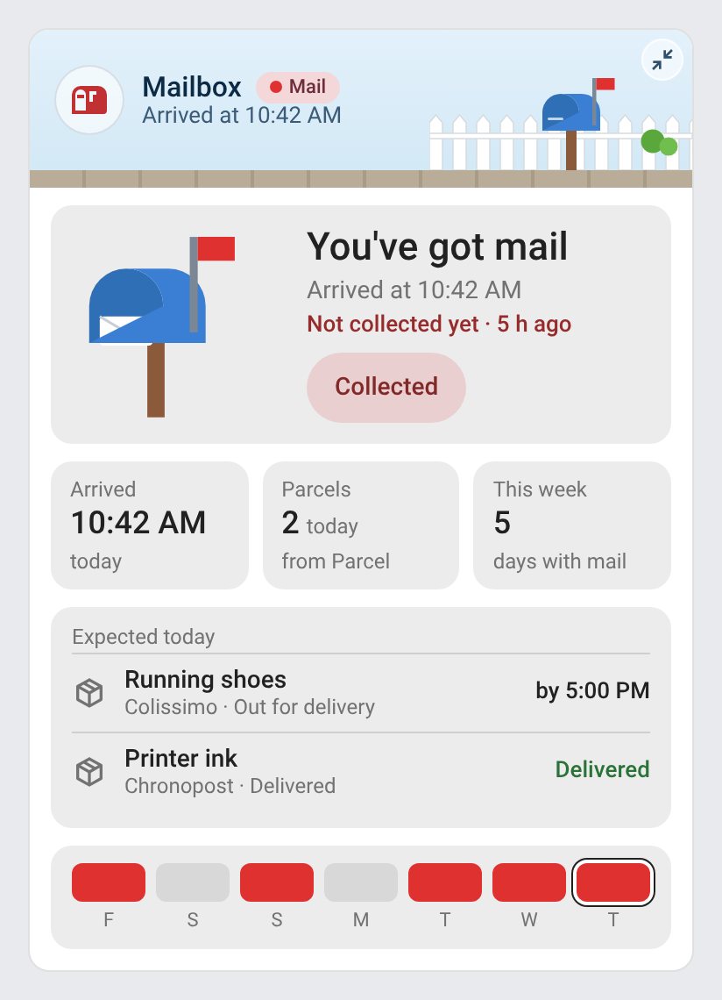 |
| 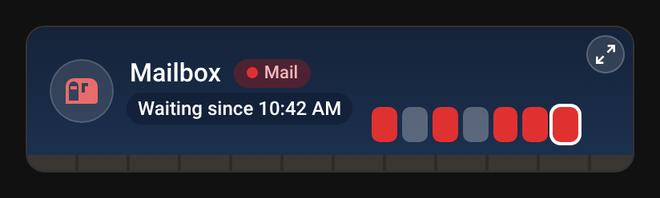 | 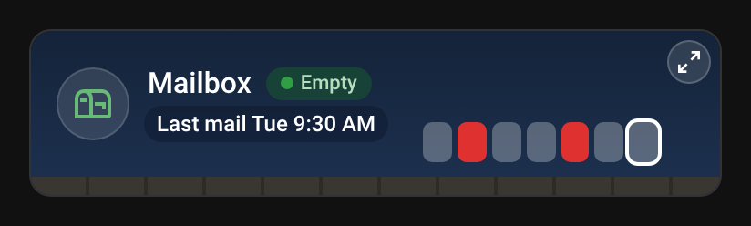 | 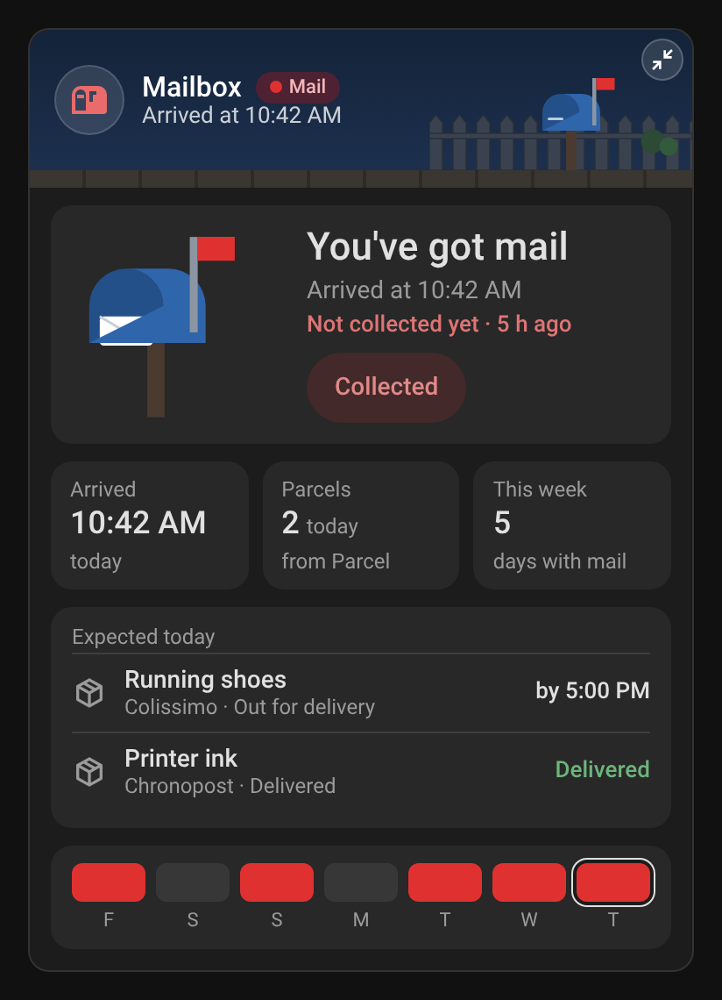 |

## How it works

- **Mail sensor**: `entity`, else the first `binary_sensor` with a word starting like a mailbox (*mail*, *letter*, *courrier*, *boîte*, *Briefkasten*…; never *gmail* or *e-mail*), never its door
- **Deliveries**: the mail sensor's turns on over the last 7 days (`history/history_during_period`, fetched at first, every 5 minutes and when a sensor changes), one per 10 minutes, none within 2 minutes of a collection
- **Collections**: the door's turns on, and the `collected` helper's time (an `input_button`'s state, an `input_datetime`'s timestamp)
- **State**: *Mail* when the last delivery came after the last collection; *Collected* when the mail was collected today; else *Empty*, with the last mail
- **Without `door` nor `collected`**: nothing tells the mail was collected, so it counts as collected at midnight: *Mail* until the end of the day, *Empty* the next day
- **Without the history** (no recorder): the mail sensor on is mail since its last change
- **Parcels**: the deliveries of `parcels` (else the Parcel integration's sensor) out for delivery, or expected today
- **Refresh**: the card redraws on each change of its sensors; the last 7 days are fetched again every 5 minutes and when a sensor changes
- **Actions**: `input_button.press` or `input_datetime.set_datetime` on the `collected` helper, nothing else

## Development

```bash
npm install
npm run build        # stamps the version of package.json into dist/ha-mailbox-card.js
npm run check        # builds and checks the bundle (run in CI)
npm test             # unit tests
npm run screenshots  # renders the cards with a mock mailbox into screenshots/ (and the GIFs, needs ffmpeg)
```

The source is split into ES modules under `src/shared/` (entry `src/shared/index.js`); `npm run build` assembles them (`scripts/bundle.mjs`) into the single file the Marketplace serves.

`dist/` is not committed: `npm run build` creates it locally, CI builds it on every push, and the release workflow attaches the built files to the release, which is where the Marketplace installs them from.

### Releasing

1. Bump `version` in `package.json`
2. Add a `## <version>` section at the top of [CHANGELOG.md](https://github.com/juju35/ha-mailbox-card/blob/main/CHANGELOG.md)
3. Push to `main`: the **Release** workflow builds the card, creates the tag and the GitHub release with the changelog section as notes, and attaches `ha-mailbox-card.js` and its translation files

## Translations

The card auto-detects the language from your Home Assistant settings. Currently supported:

| Language | Code |
|---|---|
| English | `en` |
| Français | `fr` |
| Deutsch | `de` |
| Español | `es` |
| Српски | `sr` |
| Srpski (latinica) | `sr-Latn` |
| Italiano | `it` |
| Nederlands | `nl` |
| Português (Portugal) | `pt` |
| Polski | `pl` |
| Română | `ro` |
| Dansk | `da` |
| Svenska | `sv` |
| Български | `bg` |
| Русский | `ru` |
| Українська | `uk` |
| Magyar | `hu` |
| Slovenčina | `sk` |
| Čeština | `cs` |
| Slovenščina | `sl` |
| Latviešu | `lv` |
| Ελληνικά | `el` |

Contributions for additional languages are welcome!

## License

[MIT](https://github.com/juju35/ha-mailbox-card/blob/main/LICENSE)

## Support

If you find this project useful, you can support its development:

<a href="https://buymeacoffee.com/julienstep9"></a>
